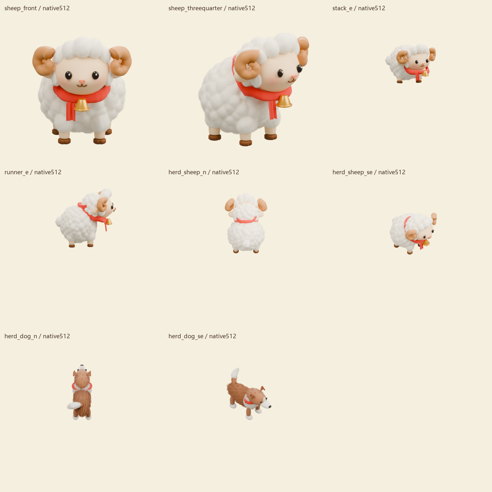
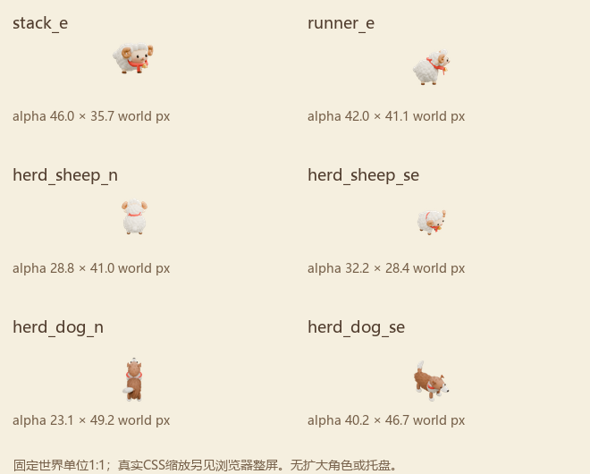
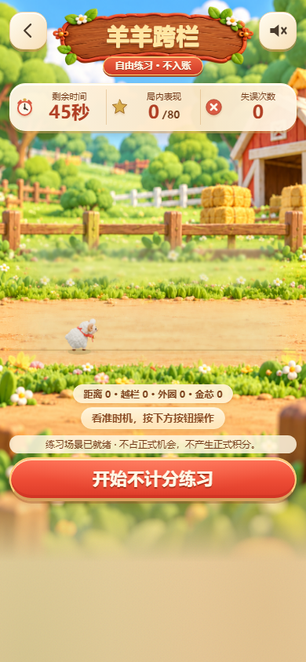

# 羊年R4 v15未通过进度

**艺术未通过，sample/production=false，S3 NOT_READY；用户未签认，继续P0。**

已保存量化基线、原生几何目标、8张有限清晰图和三款前后6张GamePage静态。下一步在原会话继续团坐与犬尾多角的少量低成本预览，随后额冠/厚角分节/布料；保留已修脸和短腿。不全量生产，不改变规则或显示映射。

[详细进度/边界](docs/r4-native-shape-report.md) · [当前绑定](review/r4/CURRENT.json) · [量化后复核](review/r4/shape-v15/SHAPE_RECHECK.md)

| 叠高静态 | 跨栏静态 | 赶羊静态 |
|---|---|---|
|  |  |  |

原生.blend、参考原件、完整原型并排和入场dirty备份仅本机保留，本次白名单同步不含它们。静态页面为原B5校验后的浏览器内存单帧试样，不是已发布的R4或完整动作。
