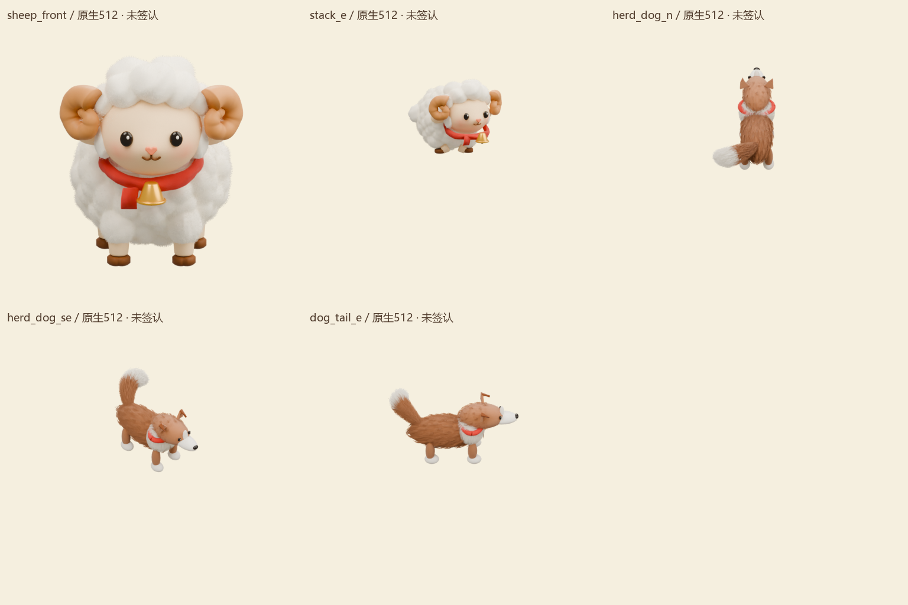
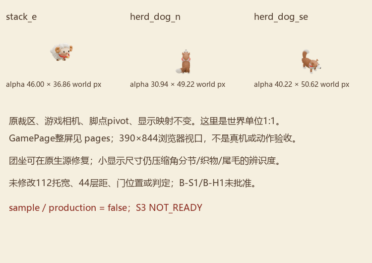
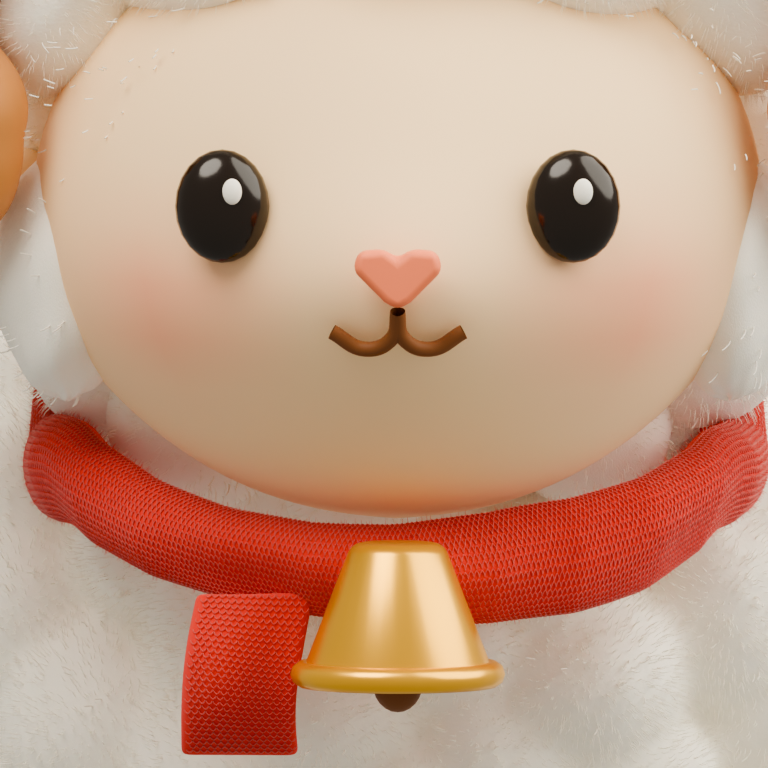
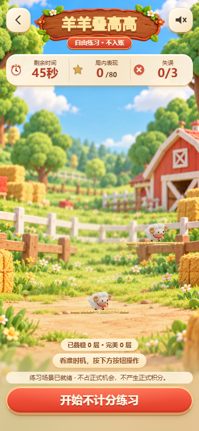
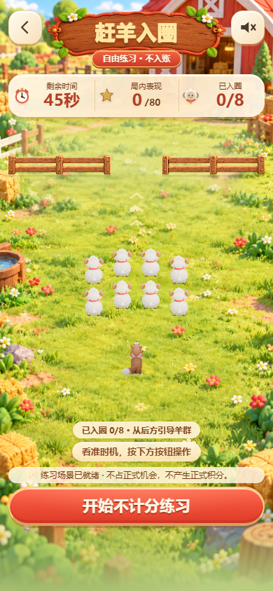

# 羊年 R4 · 团坐与羽尾母型继续返工

**艺术未获签认，sample/production=false，S3 NOT_READY；B未批准。**

当前可编辑私有母源为羊/叠高v27、犬v24。继续实改了原生折腿团坐、同一空间弯曲羽尾、融合额冠/浅柔角节和折叠针织围巾；保留已修脸和短腿，保留v15/所有上游。没有铺全图集或充动画槽。

[详细量化、原生绑定与局限](docs/r4-p0-progress.md) · [当前绑定](review/r4/CURRENT.json) · [技术核验，不是艺术通过](output/r4/p0-v27/verification.json)

页面证据为 **v27叠高 + v24犬；跑酷羊与赶羊的羊仍v15**。只替换浏览器内存中单帧，正式/候选运行资产未更换；浏览器视口非真机，无完整动作或实速录像。

| 叠高静态 | 跨栏静态（羊保留v15） | 赶羊静态（犬v24/羊v15） |
| --- | --- | --- |
|  |  |  |

规则、相机/裁区/pivot/显示映射不变。原始参考、私有并排、原生.blend、入场dirty源码、DB/cache/凭据均未随本轮导出。继续同一原会话母型自审；不要求用户接受明显失败样板。其他项目保持暂停。
