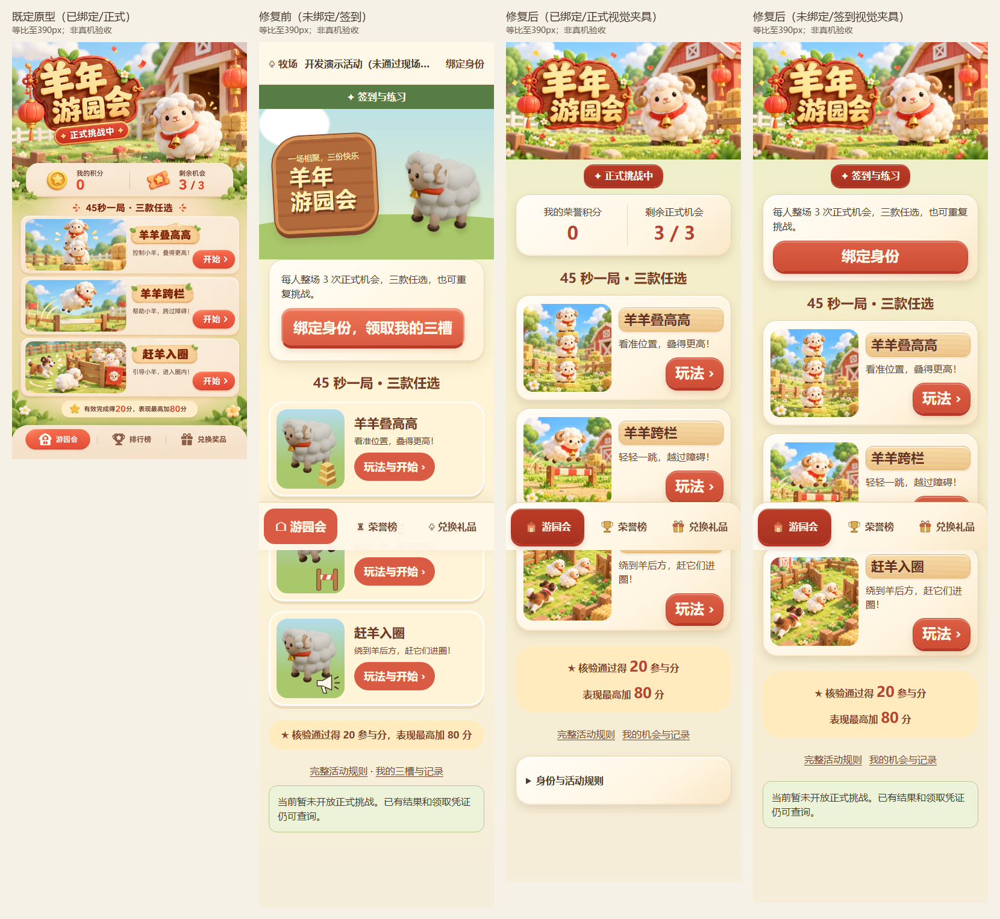

# 羊年年会游戏 · 前端与UI美术审查

这是主项目当前工作区的独立审查快照，包含三款游戏前端、共用规则核与HTTP类型、完整运行美术、既定原型和实际页面截图。服务端实现、生产数据和完整历史没有上传。

当前审查仓库已公开，可直接访问源码与图片链接。

## 最新更新

2026-10-27：提供大厅、叠高高、跨栏、赶羊入圈及共用页面的源码与实际对照；附同源角色图集、独立三维背景、母源预览和可复拍的隔离视图工具。三款正式美术保持REVIEW，真人/真机/现场未验。[发布记录](docs/releases/release-notes.md)

## 从哪里开始审查

1. 阅读 [审查指南](REVIEW_GUIDE.md)。
2. 直接复制 [ChatGPT审查提示词](CHATGPT_REVIEW_PROMPT.md)。
3. 打开下方原型/真实页面对照，然后追到实际组件、CSS和图集。

| 页面 | 原型/修复前/当前结果 |
|---|---|
| 大厅 | [查看对照图](review/lobby-comparison.png) |
| 叠高高 | [查看对照图](review/stack-comparison.png) |
| 跨栏 | [查看对照图](review/runner-comparison.png) |
| 赶羊入圈 | [查看对照图](review/herd-comparison.png) |



三款图像与原型的细绒、表情、犬材质及细节密度仍有差距，不能只看测试报告就给正式美术PASS。

## 本地检查

需要Node 24.12.x、npm 11.x。核心差分测试另需Python 3（仅标准库）。

```bash
npm ci
npm run typecheck
npm run build
npm test
npm run contracts:check
npm run rules:check
```

`npm run dev`默认在127.0.0.1:5175启动现有前端。正常业务请求仍代理到127.0.0.1:3100；本审查仓库不附后台，未启动原后台时显示连接错误属于预期，不用假接口标业务通过。主项目仍可在原目录启动完整后台。

## 独立复拍（不需要后台）

在可运行Playwright Chromium的环境先启动前端，再执行：

```bash
npm run review:lobby
npm run review:games
```

这些工具只拦截浏览器内API响应，游戏图使用共享core验证的实际输入前缀恢复GamePage。结果在output/visual-repair-v1，明确标为视图fixture，不写真实机会、积分、订单或库存。浏览器需预先安装；可使用已安装的Playwright浏览器。若使用其它空闲端口，设置REVIEW_ORIGIN为对应URL（例如http://127.0.0.1:5176）。

上传验证见 [review/upload-verification.json](review/upload-verification.json)，来源及原文件SHA见 [SOURCE_SNAPSHOT.json](SOURCE_SNAPSHOT.json)。`.blend`母源与中间渲染保留本地主项目，本仓库附其hash、预览与制作脚本。不要运行旧素材生成器覆盖运行资产。


图像读取边界：本次GitHub连接器的fetch不返回非UTF8二进制，文本读取通过也不等于看过PNG。目标ChatGPT若没有图像读取工具，请把四张对照图及角色板作为附件提供；素材已收录在本仓库，不应凭文件名给视觉PASS。
