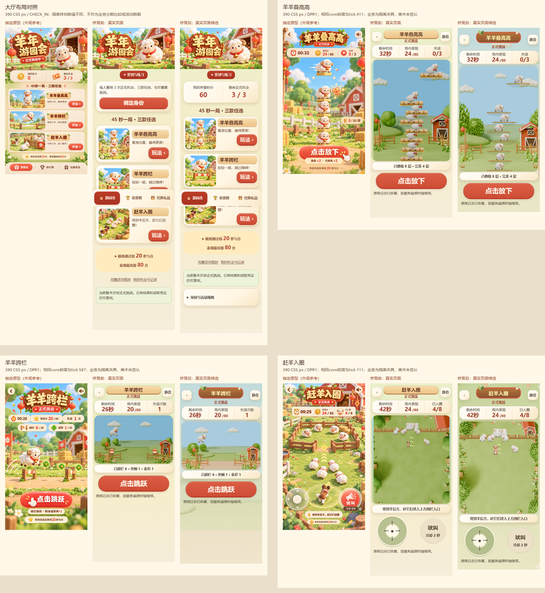

# 羊年年会游戏 · 前端与UI美术审查

公开的前端审查仓库，包含原有三款游戏、唯一规则核/HTTP契约、完整运行素材和实际视觉证据。当前已同步审查基线6e8e40c之后的修复；后台实现、凭据/数据库和大型.blend不在本快照。

## 最新更新

2026-10-27：修复订单错绑、兑换恢复、身份/输入/图片状态及二维码核销入口；补齐三款真实准备、教程和运行场景，接入v4同源角色与有界道具/背景，新增服务端成绩解释和逐项复核材料。三款美术仍为候选，G5 REVIEW/G6 BLOCKED。[完整更新记录](docs/releases/release-notes.md)

**审查入口：[进度汇报](PROGRESS.md) · [产出物索引](DELIVERABLES.md) · [F01–F18逐项报告](docs/repair-20261027-report.md) · [ChatGPT审查提示词](CHATGPT_REVIEW_PROMPT.md)**

| 页面 | 原型 / 修复前 / 当前实际页面 |
|---|---|
| 大厅 | [对照图](review/repair-20261027/comparisons/lobby.png) |
| 羊羊叠高高 | [对照图](review/repair-20261027/comparisons/stack.png) · [准备/教程/运行](review/repair-20261027/comparisons/stack-states.png) |
| 羊羊跨栏 | [对照图](review/repair-20261027/comparisons/runner.png) · [准备/教程/运行](review/repair-20261027/comparisons/runner-states.png) |
| 赶羊入圈 | [对照图](review/repair-20261027/comparisons/herd.png) · [准备/教程/运行](review/repair-20261027/comparisons/herd-states.png) |



三款对照前后是同390 CSS宽、同core输入前缀与tick，未改数字凑图。照片/截图为真实页面记录，业务fixture、原完整工程真实HTTP/PG测试、真人/真机证据严格分开。最终艺术签认和24人216局真实试玩未完成，不以截图或单测数量放行。

## 本地检查

Node >=24.12 <25、npm11；core差分测试另需Python3标准库。

```bash
npm ci
npm run typecheck
npm run build
npm test
npm run contracts:check
npm run rules:check
```

本快照测试只含core/web；完整主工程352测试和真实数据库验证是[明确标注的历史证据](PROGRESS.md)，不算本快照重跑。此次导出实际检查见 [upload-verification.json](review/upload-verification.json)。

`npm run dev`在127.0.0.1:5175启动前端，业务API仍代理到3100。本仓库没有后台，未连接原后台时的连接错误不代表后台没实现，也不能以假API替代业务验收。规则/seed/碰撞/计分仍只来自packages/game-core。

## 隔离复拍

启动前端并准备Playwright Chromium后执行：

```bash
npm run review:lobby
npm run review:games
```

可设置REVIEW_ORIGIN切换空闲端口，例如http://127.0.0.1:5176。两个工具只在独立浏览器拦截API，用真实组件/合法core前缀复拍；输出到忽略的output/repair-20261027，不写真实机会/积分/库存。更完整的逐tick/八向诊断工具在apps/web/tests/repair-audit，先derive-art-states再capture-art-runtime；它是独立renderer诊断，不冒充业务页面。

源文件映射、排除范围、未上传的重复中间帧及原生母源SHA见 [SOURCE_SNAPSHOT.json](SOURCE_SNAPSHOT.json)。提供的旧版对照仍保留在review根目录，**当前以review/repair-20261027和art1.4为准**。不要运行旧素材生成器覆盖已登记资源。GitHub页面可读不保证某个ChatGPT连接器能解码PNG；无法实际看图时必须说明并标NOT_RUN。
