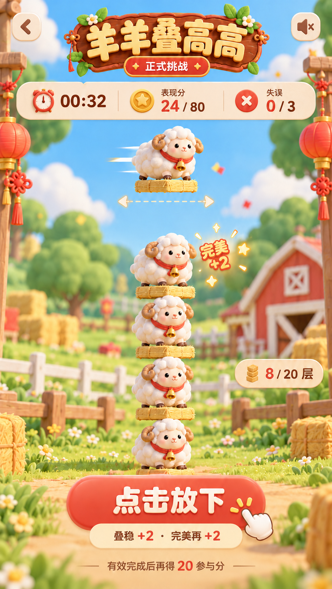
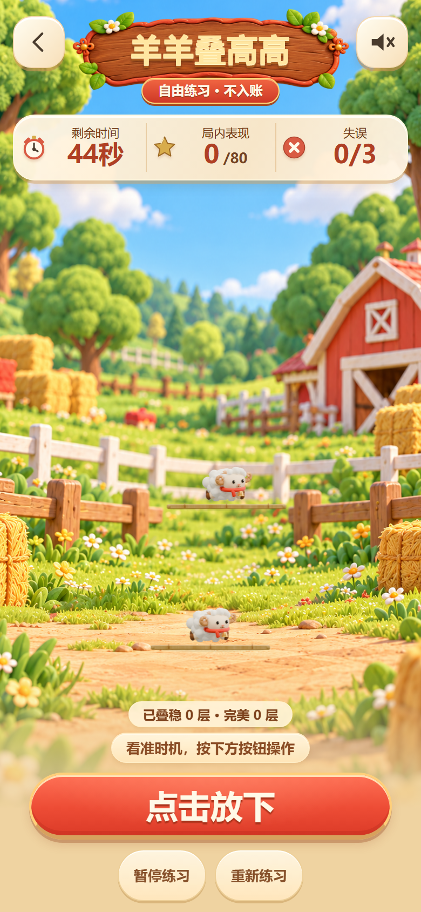
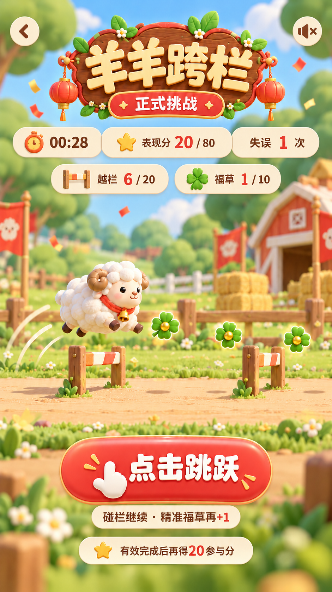
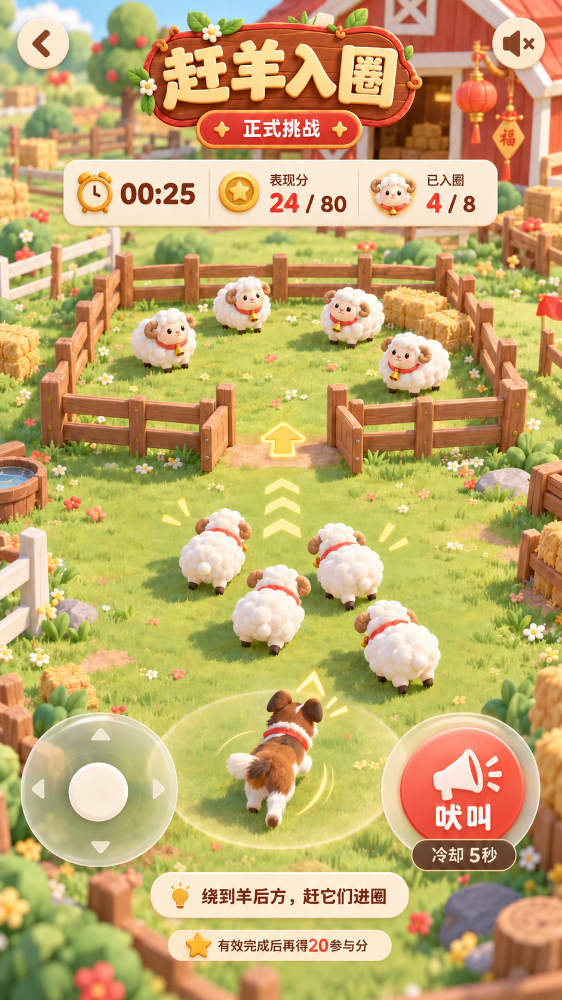
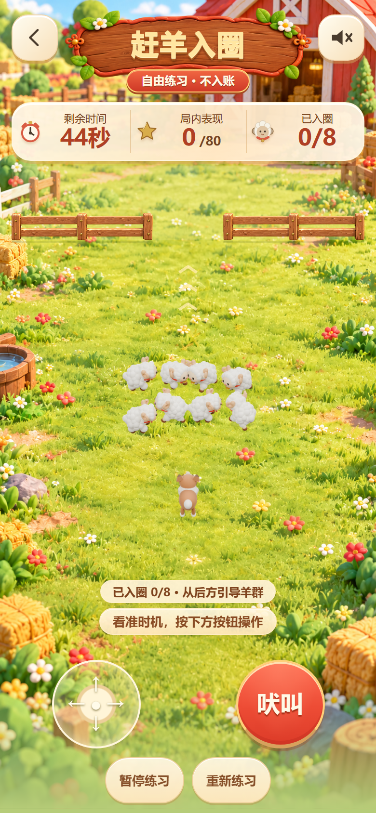

# R3-B4 独立整屏实际像素复审

**证据绑定技术PASS；三款三态艺术均PARTIAL，整轮艺术验收FAIL。S3仍未就绪。** B4确实消除了跨栏准备页蓝色顶带、赶羊双立柱，并改善了短屏场地和跨栏三态布局；角色/道具材质、叠高羊托比例、真实尺寸可辨性和部分背景收尾仍阻断原型目标。没有以测试数量、hash一致或“几何正确”代替艺术接受。

本报告只对应 `R3-B4-C-sample-a`，manifest SHA256 `68a94f88ab06e175255ee54a2d8ee0a8a666582dd4b3973bbcfd75adb871a5cb`，不复用B3的实际开图标签。已重新逐张打开当前 `review/r3/evidence/pages/` 的全部27张原始PNG：三款×准备/教程/运行×320×568、390×844、430×932。三款原型及角色板沿用本会话B3阶段已实际打开的原始像素，hash再次复核；它们仍是最高参考，候选未成为golden。完整实际开图名单、PNG/sidecar/source/页面背景hash、tick、输入前缀与表现时间范围见 [pixel-review-receipt.json](pixel-review-receipt.json)。B3目录保持历史未改；本次只写本B4审查目录，未启动浏览器、修改产品/资源或操作Git。

## 本次实际确认的改善

- 跨栏390/430准备页已没有B3的63.30/87.06 CSS px纯蓝顶带；真实准备/运行stage位置一致，教程仅受教学卡高度影响，跑道/谷仓三态位置接近。教程说明和底栏之间原先的大间隔已消失。
- 320运行页缩短标题区域，并将主操作和暂停/重练放在同一底行。叠高完整canvas从B3的178.5×238变为223.5×298；赶羊从178.5×208变为229.5×268，均增加60 CSS px高。主控仍能辨认，未见底栏截断。可见短文案为“暂停/重练”，源码的语义名称仍为“暂停练习/重新练习”。
- 赶羊左右木栏使用共享立柱和横杆，B3相邻面板的双立柱已消失；接地和圈内浅色层有所改善。真实上部门仍清楚，未画中央假门，栏杆没有跨入口。源码从RULES读取 `[0,144]`、`[216,360]` 与y76，表现修复没有改变core。

这些是具体改进，不等于三款方向已获接受。

## 三款三态九格

| 游戏/状态 | B4实际画面与剩余差异 | 艺术状态 |
|---|---|---|
| 叠高/准备 | 连续草地、谷仓、前景草垛/木栏可读，真实UI统一；小羊仍只占长托约一半，主体在完整景物中偏小。现有脸/小角/毛团/围巾与原型圆润绒毛身份仍不同。 | PARTIAL |
| 叠高/教程 | 教学卡及三按钮清楚，场景和样板未切回旧背景；320比B3略好，仍是两只小羊配很长的托，不能形成参考“羊塔为主角”的关系。教程三按钮与说明仍占较大短屏预算。 | PARTIAL |
| 叠高/运行 | 320底行重排确实增大完整场地，羊更易看见；没有解决52宽羊/112宽托、44层距约束和材质。截图为早期运行，不能据此判接触、回弹、完美/失误和自然终局动作完成。 | PARTIAL |
| 跨栏/准备 | 顶带已修，跑道和UI形成连续构图，三态更一致；小羊仍灰白平滑，页面下部还留明显纯色空间。390背景底端可见细横缝。 | PARTIAL |
| 跨栏/教程 | 教学区/场地/按钮/底栏形成顺序，旧版说明到固定底栏的大空隙已修；390/430页尾仍有较大纯色留白，430背景底端还有细横缝，不可写“整屏构图完全通过”。 | PARTIAL |
| 跨栏/运行 | 与准备页跑道位置一致，按钮和数值清楚；真实窄栏是细竖杆，福草在花草背景上仅为小绿点，和原型大物件/大羊的视觉关系仍不同。390背景底端横缝仍可见。 | PARTIAL |
| 赶羊/准备 | 木栏比B3厚实，无重复双柱，接地感有所恢复；圈内外浅色关系仍弱，上部门及薄圈内区与原型透视围合空间的差异未获接受。旧羊后背和犬身仍像泡棉/光滑体块。 | PARTIAL |
| 赶羊/教程 | 文案、箭头指向真实上方入口，木栏和场景统一程度提高；320完整换行、三按钮/底栏可见。羊毛、角、围巾、犬毛尚未达到角色板身份，圈内层次仍待细化。 | PARTIAL |
| 赶羊/运行 | 320角色和场地比B3变大、摇杆/吠叫与暂停/重练均可见；当前早期羊群仍挤成灰白团，个体脸/角/轮廓遮挡，未证明门边拥挤与过门层次完成。 | PARTIAL |

## 原图复核入口

下图均为原始文件，无重绘或合成；全部27张逐图路径及hash在receipt。

| 游戏 | 最高参考原型 | B4真实运行页390×844，DPR2 |
|---|---|---|
| 叠高 |  |  |
| 跨栏 |  |  |
| 赶羊 |  |  |

## 剩余阻断与合法下一步

1. **叠高比例必须继续明示为未解决。** 36高+2间隙+6托厚满足44层距，羊实际宽52，仅为112托宽的46%。320运行canvas增大后，羊宽由约25.8增到32.3 CSS px，但羊/托比不变。不得将放大页面场地写成解决羊的形体比例；不得压扁羊、改规则、裁世界或隐藏托盘。仍可在同母源内做合法姿态和大形/材质研究；若无法达到原型比例，提交真实尺寸对照与明确允许差异，等待用户判断，不自行设新golden。
2. **角色与道具仍需同屏统一。** 新背景、共享木栏没有替换跨栏/赶羊旧v4角色；羊的灰白毛团、小角、围巾和犬的光滑躯干，与原型的绒毛/织物差距明显。应保留同可编辑母源，先用实际像素尺寸验证身份/材质，不能靠更多帧或纤维数宣称通过。
3. **跨栏背景收尾仍可逆修正。** 顶带已解决，不能继续列作现存问题；底端细横缝和页尾纯色留白仍存在。应在纯背景合成/渐变或页面空间分配上处理，保持唯一360×220世界、真实地面、FIT与输入映射，不用改变碰撞或裁掉游戏世界去对齐背景。
4. **真实栏/福草尺度与赶羊构图差异尚未签认。** 在8/18/28栏AABB与9/3草直径内改善明暗/材质和轮廓，避免花草背景淹没目标；不能扩大可见却不可碰的物件。赶羊保持y76和144..216真门，在不移动判定/角色中心的前提下改善圈内层次、木栏接地与门边遮挡。与原型的大栏草、中央透视门之间无法消除的差异须具体呈交用户。
5. **静态矩阵不证明完整动作。** 本审阅未观看B4完整原速视频，不将root提供的runtime49 PASS解释为动作艺术PASS。接触压缩/回弹、跑步/起跳/碰撞/采集、八向连续换向、犬移动/原地吠叫、入圈拥挤/遮挡与自然终局仍须在同hash实速视频中另审。物理设备流畅度不能由录像抽帧替代。

## 技术核验与接受边界

已实际执行 `python review/r3/audit/B4/verify_review_bindings.py`，退出0：全部27 PNG、sidecar与总索引、登记源码、候选与请求的页面背景绑定PASS，27组只有一个source hashset；manifest登记的所有背景/木牌/样板/木栏图片和metadata文件hash均匹配。入口快照21项game-core/config/contracts/正式manifest/根package与lock均未变。正式manifest保持 `49eba97a27668b9c39366157714714b9d1550054453134867bbbb7e1a05bd24c`，规则保持 `ce1dd5de9aca976c16331b27443569dc95f0ed176778c202f88a0da848949a83`。

读取的完整性记录27项PASS，全部DPR请求2/实际2，配置背景锚点误差0、完整世界在stage内、一个canvas且errors为空。准备/运行静态输入前缀为空，教程来自已绑定的合法确定性教学控制器；receipt记录不同tick来源和实际前缀数量，不冒充真人数据。技术PASS仅限这些已核验的绑定/布局事实，不等于本审阅亲自运行所有浏览器/后台/并发测试。

`sample_art_accepted=false`、`production_art_accepted=false`，独立复审不是用户许可。没有用户对候选hash、三款静态方向、动态样板范围和允许差异的明确S3签认，不进入R3-D批量，不声称95%或R3-E最终完成。真机/微信、真人难度、24人216局与现场网络未由本审阅执行，保持NOT_RUN；本轮未部署或写真实业务数据。后续若候选变化，必须重新绑定/拍摄/实际开图，本27张不能作为新版本通过证据。
